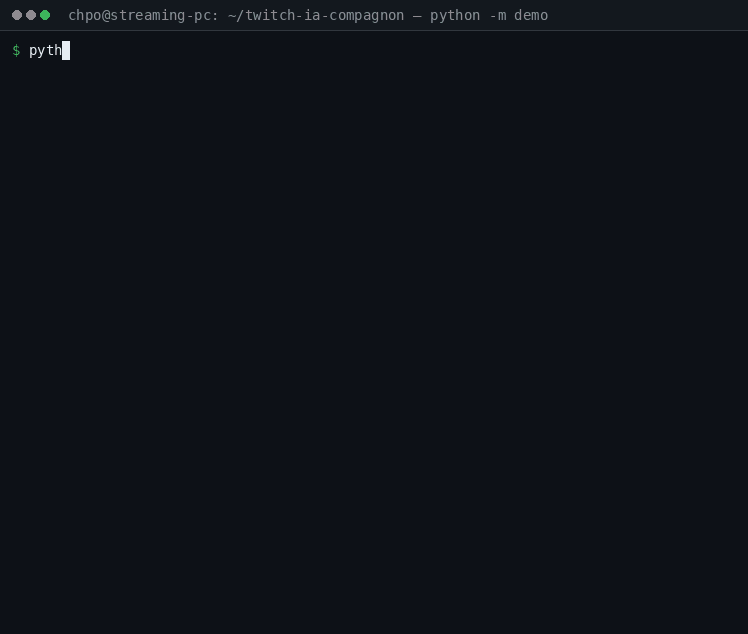

# twitch-ia-compagnon

> **⚠️ Concept / early preview — NOT a proven tool.**
> This project is an architectural exploration, built in the open. It has never driven a real stream,
> its platform adapters have never talked to the real Twitch, Kick or YouTube APIs, and it has no
> production track record. Most of what is asserted below is proven by an automated test suite against
> fakes — which is not the same thing as being proven in the field. Read [What is proven, and what is
> not](#what-is-proven-and-what-is-not) before you invest any time in it.

[](https://github.com/chpomob/twitch-ia-compagnon/actions/workflows/ci.yml)

A **multi-platform AI companion for streamers**: a multi-turn agentic brain whose input and output
**modules are its tools**. A module proposes an action, an executor runs it, and the observation returns
into the loop — the companion can read the chat, remember viewers, speak through your stream audio,
change your scene, clip a moment, moderate, or look something up on the public web, depending on what
you enable and authorize.

Twitch is one channel among several; the core is platform-neutral by construction.

## See it run, without a credential



One command replays a scripted end-to-end run and narrates it — a viewer addresses the companion, the
keyword trigger accepts the message, the brain is admitted to that viewer's session, it proposes
`audio.capture`, the observation comes back with the transcription, and the configured delivery writes
the answer to the chat and speaks it:

```bash
python -m demo          # no account, no key, no socket
```

Everything behind that narration is shipped code: the loader, the bounded admission queue, the trigger
engine, the default-deny authorization policy, the executor, the attachment store and the brain's loop.
Only four edges are scripted — the model's answers, the platform's replies, the microphone and the
speech synthesis — and every run prints which, at the end. `--platform fake` drives the same scenario
on a second platform, to show that nothing in `core/` is twitch-shaped.

Want it running on your own channel? **[Installing and running the companion](docs/installation.md)**
(also [in French](docs/installation.fr.md)) walks a non-technical reader from nothing to a companion
answering in chat: the shopping list, a ready-to-copy chat-only profile, the eight values to collect,
what each command prints, what the errors mean, and what is still unproven.

## What is proven, and what is not

**Proven by the test suite** (~3,100 passing tests, with 13–18 environment-dependent skips). A GitHub
Actions matrix runs that suite on **Python 3.10, 3.11, 3.12 and 3.13** — see the badge above:

- The kernel: bounded admission, explicit terminal outcomes for every action call, a single global
  startup/shutdown deadline, bounded retention, and secret redaction in traces and diagnostics.
- **Default-deny authorization**, reads included: nothing happens without a rule the operator wrote.
- 21 modules with declared manifests and machine-readable settings schemas (one of them, the
  automation bridge, is not delivered — see below).
- **Declared triggers**: an input declares the trigger types its events can be selected by, and the
  kernel evaluates them; a trigger only decides candidacy, admission and authorization still decide
  the rest. See the [triggers guide](docs/triggers.md) (also [in French](docs/triggers.fr.md)). The
  four families below are proven against fakes only:
- **Channel points** (`twitch`, `reward`): a redemption of a listed reward, within an optional cost
  range, triggers a run — proven against fakes only (a fake platform replaying the redemption
  notification); fulfilling or refunding is out of scope.
- **Operator button** (`operator`, `button`): one configured button pressed from a local page, an
  overlay browser source or a hotkey bound to the shipped press command — proven against fakes only
  (no real browser, no real key binding).
- **Listening** (`audio_input`, `wake_word` and `keyword`): opt-in, detection by detection — a
  configured wake-word detector, then one bounded segment transcribed only for an accepted wake word
  — proven against fakes only (a fake detector and recorder, no microphone); continuous listening is
  out of scope.
- **Timer** (`timer`, `interval`): every N minutes, with a probability and an optional time-of-day
  window — proven against fakes only (an injected clock and random source).
- **Web knowledge** (`web`): `web.search` (Wikipedia by default, with no key; Brave Search as an
  option) and `web.read` (one public page, as bounded text), off until two rules grant them, behind
  a network guard that refuses loopback, private and other non-public addresses at every hop. See
  the [web knowledge guide](docs/web-knowledge.md) (also [in French](docs/web-knowledge.fr.md)).
- The configuration UI: a separate process, loopback-bound, token- and CSRF-guarded, generating one page
  per module from its manifest, writing an **overlay** and never the base file.
- The full specification/plan pipeline output, including nine closing-gate passes whose reports are in
  this repository (see [How this was built](#how-this-was-built)).

**Explicitly NOT proven — treat these as unknown, not as working:**

- **No real stream has ever been run with it.** There is no field experience of any kind.
- **The platform adapters have never been exercised against the real platforms.** Twitch, Kick and
  YouTube are covered by tests using fake transports. Their authentication, rate limits, message formats
  and edge cases are unverified against the live services.
- **The configuration UI's browser layer is unverified.** Its HTTP contract and rendering are tested;
  **no real browser session, no JavaScript execution, and no live load test has been performed.**
- **Provider trials are skipped by default.** The audio (TTS/STT), scene-control and platform trials are
  opt-in test nodes that require your own credentials; they are collected and skipped in a normal run.
  One real integration trial was performed during development (an OBS `obs-websocket` v5 scene change),
  and its record is in `docs/campaigns/phase2/scaffolding/obs-trial-record.md`.
- **Automation bridge (`streamerbot`): not delivered — awaiting real-instance trial.** The optional
  module that connects the companion to a stream-automation application you already run (sink,
  cues, replaced chat or viewer inputs) is proven only against a fake instance replaying documented
  frames. Its eight trial questions are opt-in nodes in `tests/test_phase5_trials.py`; see the
  [operator guide](docs/automation-bridge.md) (also [in French](docs/automation-bridge.fr.md)).
- **The web providers are proven against fakes only.** Wikipedia and Brave Search are exercised by
  the suite through a fake transport replaying their documented answers; no test contacts a real
  network, and real-socket address pinning is proven only by unit checks. The real-instance check is
  a manual operator trial described in the [guide](docs/web-knowledge.md), recorded in
  `docs/campaigns/phase7/web-trial-record.md` when run.
- **No production hardening.** No deployment story beyond "run it on your machine", no upgrade path, no
  multi-user operation, no load or soak testing.
- The configuration model is heavy: a ~500-line YAML profile plus up to 25 environment variables. The UI
  is the intended answer to that, and it is new.

If you want something dependable today, this is not it yet. If you find the architecture interesting —
or you want to help make it real — read on.

## Architecture

```
          ┌─────────────── core/ ───────────────┐
 inputs → │  bus · admission · triggers · brain │ → outputs
          │  actions (default-deny) · audit      │
          └──────────────────────────────────────┘
              ↑ manifests                 ↓ observations
     modules/twitch · kick · youtube · chat_context · users · capture · clips ·
     audio_input · audio_output · stream_control · viewer_memory · moderation ·
     watch · web · brain · proxy · agent_link · audit · operator · timer ·
     streamerbot (optional bridge)
```

- **The brain** runs a bounded multi-turn loop: it reasons, proposes a *read* action, receives the
  observation, and ends on an explicit terminal outcome. It never selects the **delivery** — the
  operator configures an ordered list of delivery actions.
- **Every action is authorized explicitly.** There is no implicit allow; a destination without a rule is
  refused, reads included.
- **Every call is bounded**: per-action deadlines, budgets, a bounded queue per session, and stale-work
  dropping that is recorded rather than silent.
- **Two deployment profiles**: everything on the streaming PC, or the brain on a remote host with a
  PC-side agent over a JSON proxy (`docs/proxy-protocol.md`).

## Quick start

Requires Python 3.10+.

```bash
python3 -m venv .venv && . .venv/bin/activate
pip install -e ".[test]"

# 0. See it run first: one scripted scenario, narrated end to end, no credential.
python -m demo   # --platform fake drives the same run on a second platform

# 1. Look at a shipped profile before writing your own.
ls *.example          # config.yaml.example (PC profile, chat + audio + scenes)
                      # presence.yaml.example (the full phase-3 profile: persona, routes, memory…)
                      # config.server.yaml.example + agent.yaml.example (the remote profile)

# 2. Validate a profile without opening a single socket (exit 0 = accepted, 2 = refused).
#    The shipped examples reference ${...} variables, so expect a refusal until you export them.
python -m core.main --config presence.yaml.example --check-config

# 3. Run the companion.
python -m core.main --config my-config.yaml

# 4. Serve the local configuration UI (loopback only, prints a one-time access URL).
python -m core.config_ui --config my-config.yaml

# 5. The test suite.
python -m pytest tests/ -q
```

### Configuration in two minutes

- **Secrets are never literals.** A profile refers to `${NAME}` environment references; the runtime
  resolves them and redacts them everywhere. The UI shows whether a reference is set — never its value.
- **The UI writes to an overlay** (`my-config.local.yaml` next to `my-config.yaml`: the base name with
  `.local.yaml` in place of `.yaml`), merged over the base, so the commented example stays intact.
  Removing an override restores the base value.
- **Applying a change is a supervised restart** — there is no hot reload in this version.
- `secrets` and the authorization rules (`actions`) are **read-only in the UI**: a single mis-click must
  not be able to widen what the companion is allowed to do.

## Project layout

| Path | What it is |
|---|---|
| `core/` | The kernel: bus, admission, triggers, brain loop, actions, loader, runtime, audit |
| `core/config_ui/` | The local web configuration UI (separate process) |
| `demo/` | The offline demo (`python -m demo`): the scripted scenario, narrated |
| `modules/` | 21 modules, each with a `module.yaml` manifest declaring its actions, schema and capabilities |
| `modules/web/` | Web knowledge: `web.search` (Wikipedia by default, Brave optional) and `web.read`, behind the network guard |
| `modules/twitch/` | The Twitch input and chat delivery, including channel points (`reward`) — proven against fakes only |
| `modules/audio_input/` | Audio capture, and opt-in listening on a configured wake-word detector — proven against fakes only |
| `modules/operator/` | The operator's button: local page, overlay browser source and press command — proven against fakes only |
| `modules/timer/` | A timed random trigger: every N minutes, a probability, an optional window — proven against fakes only |
| `modules/streamerbot/` | The optional automation bridge — not delivered — awaiting real-instance trial |
| `tests/` | ~3,100 tests over Python 3.10–3.13, plus opt-in real-integration trials |
| `docs/design-v2.md` | The design blueprint the phases implement |
| `docs/installation.md` | Installing and running it, for a non-technical reader (French) |
| `docs/config-ui.md` | Operator documentation for the configuration UI |
| `docs/proxy-protocol.md` | The remote-deployment proxy protocol |
| `docs/automation-bridge.md` | Operator guide for the optional automation bridge (also in French) |
| `docs/web-knowledge.md` | Operator guide for web knowledge: settings, network guard, grant and Brave fragments, operator trial (normative; also in French) |
| `docs/triggers.md` | Operator guide for triggers: generic and declared types, the four families with examples, the manual trial (normative; also in French) |
| `docs/campaigns/phase{1,2,3,4,5}/` | The specifications, plans, per-step specs, gate prompts and **gate reports** of each delivery phase |

## How this was built

This project is developed through an **adversarial pipeline**, and its records are part of the
repository:

1. A **specification** is written from a brief, then challenged by a different model until it holds.
2. A **plan** breaks it into ordered, independently verifiable steps.
3. Each step runs as its own loop: one model implements, a **different** model reviews, and the step
   lands as a single atomic commit with a green suite.
4. A **delivery phase ends with a full-branch gate** that reviews the whole cumulative diff, replays its
   own counterexamples and postulates new defects.

That last part is where this repository is most honest about itself. Phase 4's gate took **nine passes**;
each pass re-ran the previous counterexamples and reported what it could still break. It found 13 real
defects — including a configuration path that could overwrite the base configuration file, a secret
disclosure for short secret values, and three defects **introduced by earlier fixes** — every one
reproduced. `docs/campaigns/phase4/scaffolding/gate-report-1..9.md` are those reports, unedited.

## License

**WTFPL v2** — *Do What The Fuck You Want To Public License* (see [`LICENSE`](LICENSE)). In practice: use
it, fork it, ship it, commercially or not, with no conditions. It comes with **no warranty of any kind**
and **no support** — which is the honest position for a preview that has never run a real stream.

## What would make this real

- Running it against live Twitch, Kick and YouTube channels, and recording what actually breaks.
- Exercising the configuration UI in a real browser, with a real editing session.
- A deployment story (packaging, upgrades, supervision) and load testing.
- Closing the loops the trials open: the opt-in trial nodes are the checklist of what remains unverified.
